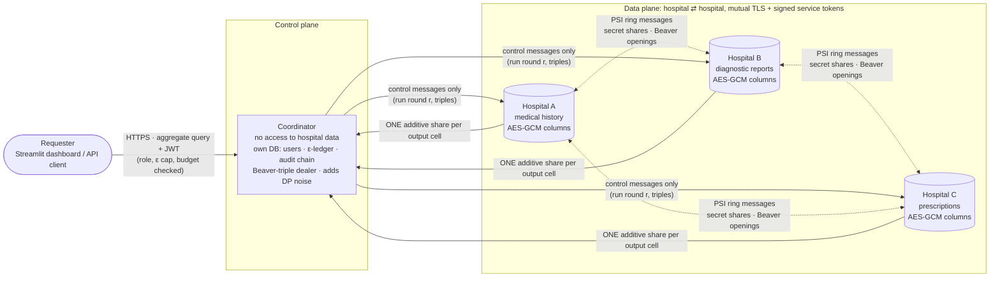

# Privacy-Preserving Federated Healthcare Query System

A research / portfolio prototype that asks one question:

> **Can hospitals collaborate and answer useful statistical questions about patients without exposing any individual patient's private data?**

Three simulated hospitals each hold a *different slice* of an overlapping patient population:

| Hospital | Holds | Example fields |
|---|---|---|
| **A** | medical history | demographics, chronic conditions, diagnoses with dates |
| **B** | diagnostic reports | lab results, imaging findings, follow-up outcome (improved / no change / worsened) |
| **C** | prescriptions | drug, dose, start/end dates, prescribing reason |

The system answers aggregate questions such as *"How many patients with condition X who were prescribed treatment Y showed a positive response?"* — which needs data from all three hospitals — while no hospital ever sends raw patient records to another hospital or to the coordinator.

**All data is synthetic.** The generator never reads or downloads real patient data.

> **Status:** phases 1–7 are implemented and tested (the federated-learning stretch goal is [not started](#project-status)). Read [`THREAT_MODEL.md`](THREAT_MODEL.md) for what this prototype does **not** protect against and [`evaluation/RESULTS.md`](evaluation/RESULTS.md) for measured attacks, accuracy and performance.

---

## Quick start (Windows / macOS / Linux, no Docker needed)

```bash
python -m venv .venv
.venv\Scripts\activate            # macOS/Linux: source .venv/bin/activate
pip install -e ".[dev,dashboard,eval]"

python scripts/gen_keys.py                                       # data keys, JWT secret, audit key, demo users -> ./secrets (gitignored)
python scripts/gen_certs.py                                      # private CA + one certificate per service -> ./secrets/tls
python -m fedhealth.synth.generate --patients 5000 --seed 42     # writes ENCRYPTED ./data/*.db + ./data/ground_truth/

python scripts/run_local.py --secure                             # STRICT: mutual TLS, service identities, private API (terminal 1)
# or, for development and the evaluation baselines:
python scripts/run_local.py                                      # plain http, insecure baseline routes enabled

pytest                                                           # whole suite, 340 tests (~5 min); add -m "not slow" to skip real-process / TLS / full-size tests
```

Ports: coordinator `8000`, hospitals A/B/C `8001/8002/8003` (see `configs/topology.yaml`). Demo users (`researcher1`, `clinician1`, `auditor1`) and their random passwords are written to `secrets/DEMO_CREDENTIALS.txt`.

Ask a private question against the strict system (the coordinator's certificate is signed by the local CA):

```bash
TOKEN=$(curl -s --cacert secrets/tls/ca.pem https://127.0.0.1:8000/auth/login \
        -H 'content-type: application/json' \
        -d '{"username":"clinician1","password":"<from secrets/DEMO_CREDENTIALS.txt>"}' | python -c "import sys,json;print(json.load(sys.stdin)['access_token'])")
curl -s --cacert secrets/tls/ca.pem https://127.0.0.1:8000/v1/query -H "authorization: Bearer $TOKEN" \
     -H 'content-type: application/json' \
     -d '{"query":{"agg":"count","condition":"E11","a":{"age_min":40,"age_max":65},"b":{"outcome":"improved"},"c":{"drug":"metformin"}},
          "privacy":{"epsilon":1.0}}'
```

## Dashboard (Streamlit)

```bash
python scripts/run_local.py --secure          # terminal 1: the strict system
streamlit run fedhealth/dashboard/app.py      # terminal 2   (FEDHEALTH_COORDINATOR_URL / FEDHEALTH_CA override the defaults)
```

* **Log in as a role** (`researcher1`, `clinician1`, `auditor1`; passwords in `secrets/DEMO_CREDENTIALS.txt`). The query form, the allowed aggregates and the ε slider are limited by the role's policy.
* **Build an aggregate query from dropdowns** — condition, treatment, outcome, age range (plus sex, aggregate, value / group-by). A hospital takes part only if one of its filters is used. The exact JSON that is sent is shown in an expander.
* **Choose ε, see the remaining budget** in the sidebar, then the **noisy result** with its typical noise, the ε it cost, which hospitals took part and the audit entry number. Suppressed answers (cohort < k) are explained and still charged; histograms get a chart and a table.
* **"Ground truth (demo mode only)"** — start the dashboard with `FEDHEALTH_DEMO_MODE=1` (and `FEDHEALTH_GT_DIR=data/ground_truth`) to get a toggle that shows the true value and the error the noise caused. This is the one thing a real requester could never see, so it reads the synthetic CSVs *in the dashboard process*; the coordinator and hospitals never touch them.
* **Audit tab**: your own entries (auditors: everyone's), and for auditors a live **integrity banner** — ✅ chain verified, or ❌ tampering detected at entry #N — plus all privacy-budget balances.

The dashboard talks only to the coordinator's authenticated HTTPS API. `tests/test_dashboard.py` drives it headlessly (Streamlit's `AppTest`) against an in-process strict system: login failure, role-limited widgets, a full query with the budget moving, histograms, the demo-mode toggle, suppression and the integrity banner turning red after the audit database is tampered with.

## Docker Compose

```bash
docker compose --profile setup run --rm setup   # one time: keys, certificates, encrypted synthetic databases -> ./secrets, ./data
docker compose up --build                        # 3 hospitals + coordinator + dashboard
# dashboard: http://localhost:8501     coordinator API: https://localhost:8000
```

> ⚠ **Not executed here.** Docker is not installed on the machine this project was built on, so `docker-compose.yml` and the `Dockerfile` were validated *statically* (parsed, and the properties below asserted by `tests/test_deployment.py`) but never run. The identical topology — four processes, mutual TLS, service identities — *is* exercised for real by `python scripts/run_local.py --secure` and `tests/test_e2e_tls.py`. Expect to fix small things on the first real `docker compose up`.

Least privilege by construction: a hospital mounts only **its own** database, **its own** data key and TLS key, and the others' *public* certificates; the **coordinator mounts no hospital database or key** (just its own SQLite volume, the JWT/audit keys and its TLS key); the dashboard mounts only the CA certificate; hospitals publish **no ports** (only the coordinator `8000` and dashboard `8501` are reachable from the host); `ALLOW_INSECURE_BASELINE` is never set; the image runs as a non-root user and contains no data or secrets.

## Architecture



Key design points (details in the plan and, as phases land, in the per-technique sections below):

* **Each hospital is an independent FastAPI service with its own SQLite file.** The coordinator has *no* database access to any hospital (it imports no hospital code and has no hospital DB path — enforced by `tests/test_architecture.py`).
* **Aggregate-only.** The query language has no `SELECT`, no columns and no free text. Only `count | sum | avg | histogram` over a closed vocabulary exist; anything else fails schema validation. Hospitals re-validate their own slice, build SQL with bound parameters only, and expose **no** endpoint that returns rows (route table is asserted in tests).
* **Each hospital sees only its own slice of a query** (plus the condition code shared by all three) — never the other hospitals' predicates.
* **Insecure baseline kept on purpose.** `POST /insecure/query` joins raw national IDs in the clear. It is opt-in (`ALLOW_INSECURE_BASELINE=1`), exists so the evaluation can compare against "no privacy", and is the contrast case for the leak scanner.

## The synthetic data

`python -m fedhealth.synth.generate` first builds one latent population (5,000 people with ages, sexes, ZIPs, correlated chronic conditions, treatments and responses) and then *projects slices of it into the three hospitals*, so records are internally consistent across hospitals:

* Overlap (exact, seed-deterministic): A∩B∩C 40% · A∩C 12% · A∩B 8% · B∩C 5% · A-only 15% · B-only 10% · C-only 10% → A = 3,750, B = 3,150, C = 3,350 patients.
* Every hospital uses its **own local MRN**; the cross-hospital linkage key is a synthetic `national_id` (`SYN-` + 9 digits).
* Eight chronic conditions (ICD-10), each with a guideline-style formulary (some drugs deliberately rare → small cells for the k-threshold) and a condition-specific lab (HbA1c, systolic BP, FEV1, eGFR, NT-proBNP, PHQ-9, LDL).
* Response follows a logistic model of drug effect, adherence, age, comorbidity and severity (≈50% improved overall); the lab change always agrees with the categorical outcome.
* Invariants tested: unique IDs, referential integrity, diagnosis < prescription ≤ follow-up ≤ as-of date, prescriptions/outcomes only for conditions the person really has, determinism for a given seed.
* `data/ground_truth/` holds the full universe for **tests, evaluation and the dashboard's demo mode only**; no service ever reads it (also asserted in tests).

## Query semantics

`{agg, condition, a?, b?, c?, value_field?, group_by?}` — "condition X" means: **A** has condition X (+ optional age/sex filter) · **C** has a prescription of drug Y *for reason X* · **B** has a follow-up outcome *for X* (optionally `improved`). A patient counts only if every participating hospital matches.

| `agg` | needs | releases |
|---|---|---|
| `count` | — | number of matching patients |
| `sum` / `avg` | `value_field` ∈ `age` (A), `lab_delta` (B), `adherence_pct` (C) | clamped, integer-scaled sum / mean |
| `histogram` | `group_by` ∈ `sex`, `age_band` (A), `outcome` (B), `drug` (C) | one count per category (each patient in exactly one bin) |

## Privacy techniques

| # | Technique | Module | Status |
|---|---|---|---|
| 1 | Private set intersection (commutative encryption) + HMAC baseline | `fedhealth/privacy/linkage/` | ✅ Phase 2 |
| 2 | Secure multi-party computation (additive shares + Beaver triples) | `fedhealth/privacy/smpc/` | ✅ Phase 3 |
| 3 | Differential privacy + per-requester ε ledger | `fedhealth/privacy/dp/` | ✅ Phase 4 |
| 4 | Small-cell suppression (k-threshold) | `fedhealth/privacy/suppression.py` | ✅ Phase 4 |
| 5 | JWT + role-based access control | `fedhealth/privacy/access_control/` | ✅ Phase 5 |
| 6 | AES-GCM at rest, mutual TLS in transit | `fedhealth/privacy/encryption/` | ✅ Phase 5 |
| 7 | Hash-chained audit trail | `fedhealth/privacy/audit.py` | ✅ Phase 5 |
| 8 | Federated learning — FedAvg (stretch goal) | `fedhealth/privacy/federated/` | ✅ Phase 8 |

Each section states **what it protects against** and **what it does NOT protect against**; `THREAT_MODEL.md` collects the assumptions and limitations.

### 1. Privacy-preserving record linkage — private set intersection (PSI)

*Module:* `fedhealth/privacy/linkage/` (`group.py`, `psi.py`, `hmac_baseline.py`) · hospital endpoints `fedhealth/hospital/routes_psi.py` · driver `Orchestrator.link()`.

**Problem.** A query that joins condition (A), treatment (C) and outcome (B) must know which records are the *same patient* — but the hospitals must not hand each other their patient lists.

**How it works (Diffie-Hellman-style commutative encryption).**
Every hospital hashes each patient's national ID into a group (`H(id)`, a quadratic residue mod a 2048-bit safe prime) and holds a fresh secret exponent `k`. "Encrypting" is `x ↦ x^k mod p`. Because `(x^a)^b = (x^b)^a`, encrypting under *all* hospitals' keys gives the same value in any order, so two hospitals hold the same patient **iff** the fully-encrypted values match.

```
ring A → B → C → A        (n hops, n = number of hospitals in the query)
round 1  each hospital encrypts its OWN hashed list with its key and sends it to the next
round r  each hospital encrypts the list it was handed and passes it on
round n  every list has been encrypted by everyone and arrives back at its owner, in the owner's order
publish  each owner sends 128-bit tags of its fully-encrypted list to the others
finalize every hospital intersects the tag sets → a common, sorted "linked index"; patient p has the
         same index i at every hospital that holds p. The group key is then destroyed.
```

Design choices worth knowing:

* **Linkage runs on the full patient lists, not on the filtered ones.** PSI over filtered sets would leak each predicate's selectivity through the set sizes (an un-noised count) and would tell hospital A which of *its* patients satisfy *other* hospitals' predicates. Linking first and evaluating predicates afterwards (inside MPC from Phase 3) avoids both. The result is cached per hospital-subset.
* **Hospital → hospital data plane.** The coordinator only sends "run round r" and waits at a barrier; it never receives a ciphertext, a tag or an ID. A hospital's `init` reply doesn't even reveal its list size.
* **Each hospital decides which crypto it accepts** (`psi_groups`), so a rogue coordinator can't downgrade it to a weak group.
* The 2048-bit prime is *computed* from its RFC 3526 definition (Machin's formula for π), and tests verify it is a safe prime.
* **Speed:** pure Python `pow` costs ≈4.2 ms per 2048-bit exponentiation; with optional `gmpy2` (`pip install -e ".[fast]"`) ≈0.56 ms. Full-size linkage (5,000 patients): A+B+C → 2,000 linked patients in ≈24 s, A+C → 2,600 in ≈11 s (in-process, all three hospitals sharing one Python interpreter; separate processes are faster). Cached afterwards.

**Protects against**
* A hospital (or the coordinator, which sees nothing) learning patients it does not already share — only the intersection is revealed to its members.
* Dictionary / enumeration attacks on identifiers: a party can apply only *its own* key, so it cannot even test whether a guessed ID is a patient elsewhere (`tests/test_psi.py::test_hmac_leaks_membership_of_non_shared_patients_but_psi_does_not`).
* Cross-session linkability: fresh keys per session produce unrelated ciphertexts.

**Does NOT protect against**
* **Malicious** hospitals (honest-but-curious only): a cheating party could submit a made-up list to probe whether a specific patient is shared.
* **Collusion** between hospitals, and the intersection itself: members of the intersection learn that the patient is shared (this is the PSI output by design).
* **List sizes** (each hospital learns the others' list sizes; the coordinator learns the size `m` of the linked cohort).
* Anything about what happens *after* linkage — that is the job of the next techniques.

**Baseline for comparison — keyed-HMAC pseudonymisation** (`hmac_baseline.py`): all hospitals share a key `K` and exchange `HMAC(K, id)` for *every* patient. It yields the same intersection, but anyone holding `K` can pseudonymise every candidate ID and learn whether *any* person is a patient at another hospital; every hospital must ship its whole list; one leaked key exposes everything. The test above demonstrates it recovers all 60 non-shared patients that PSI keeps hidden.

**Verified by** `tests/test_psi.py` (see also the SMPC section below): PSI equals the plain intersection for random 2- and 3-party sets (plus empty / disjoint / identical edge cases); service-level cohort sizes equal the generator's exact overlap (full size, real 2048-bit group); PSI-linked queries equal both the plain baseline and independent ground truth on random queries; a **leak scanner** finds no identifier, MRN, field name or plain hash in any message of a full linkage — while the same scanner flags the insecure baseline.

### 2. Secure multi-party computation — additive secret sharing + Beaver triples

*Module:* `fedhealth/privacy/smpc/` (`field.py`, `sharing.py`, `beaver.py`, `protocol.py`) · hospital endpoints `fedhealth/hospital/routes_mpc.py` · driver `Orchestrator.mpc_query()` · dealer `coordinator/dealer.py`.

**Problem.** After linkage the three hospitals must compute "how many linked patients satisfy A's *and* B's *and* C's predicate?" — but each predicate result is itself sensitive patient information. No hospital, and not the coordinator, may see another hospital's per-patient answers or its partial count.

**How it works.** All arithmetic is in the field Z_p, p = 2⁶¹−1.

1. **Vectors.** After PSI every hospital has the same ordered list of *m* linked patients. Locally it builds a 0/1 vector over that list: `ind_h[k] = 1` iff linked patient *k* satisfies hospital *h*'s predicate. The answer is `COUNT = Σₖ ind_A[k]·ind_B[k]·ind_C[k]`; `SUM` / `AVG` / `HISTOGRAM` multiply in a value vector or one-hot bin vectors held by one hospital (the *owner*).
2. **Share.** Each hospital splits every vector into *n* **additive shares** (`s₁+…+sₙ = secret`, all but one uniformly random) and sends one to each hospital. Any n−1 shares are statistically independent of the secret — information-theoretic security, no assumption.
3. **Multiply.** Sums of shares are local, but products need interaction. **Beaver triples** `(x, y, z=xy)`, dealt by the coordinator before the query, turn each multiplication into: open `d = a−x`, `e = b−y` (uniformly random, so they reveal nothing), then `[ab] = [z] + d[y] + e[x] (+ d·e at one party)`. A 3-hospital count needs two layers (`ind_A∘ind_C`, then `∘ ind_B`).
4. **Reveal.** Each hospital sums its product shares locally → one share per output cell → sends it to the coordinator, which adds them mod p. The coordinator learns the final aggregate and nothing else; Phase 4 noises it before release.

Where your original description fits: *"each hospital computes its partial result locally and splits it into additive shares"* — with vertically partitioned data a hospital's private input is its indicator vector, and the share each hospital finally sends is its "partial". `sharing.secure_sum` implements the textbook scalar version of the same idea (used in tests and as the explanation primitive).

Design points:
* **The coordinator is a conductor.** It triggers each step and waits (a barrier); shares and Beaver openings flow hospital → hospital. The only data-plane bytes the coordinator receives are the final output shares.
* **Each hospital gets only its own predicate slice** (plus the condition code). Hospital A never learns that C was asked about metformin.
* **The query *shape* is public**: which hospitals take part, the number of output cells, and the cohort size *m* (the coordinator needs *m* to deal triples).
* One hospital alone (e.g. "count of prescriptions of drug Y") needs no sharing: its local aggregate is already the answer.

**Protects against**
* A hospital learning another hospital's per-patient predicate results, or any partial count (shares are uniformly random; verified by a wire scan that finds no small integer — no 0/1 indicator, no count — in any message).
* The coordinator learning anything but the final aggregate and the query shape.

**Does NOT protect against**
* **The final answer itself** — the coordinator can add the shares and see the *exact* count. Hiding what the answer reveals about individuals is differential privacy's job (Phase 4).
* **Collusion:** the coordinator (as dealer) + one hospital can recover another hospital's vectors (it knows `x`, the hospital sees `d`); two hospitals that know their own vectors learn the third's from the output.
* **Malicious** hospitals: a hospital that sends a wrong share silently corrupts the result (semi-honest protocol, no MACs).

**Verified by** `tests/test_smpc.py` (shares uniform by chi-square for secrets 0 and 1; Beaver multiplication fuzzed for 2–4 parties; the constant term must be added exactly once; triples are single-use; secure dot-product equals plain arithmetic) and `tests/test_mpc_service.py` (MPC == plain baseline == independent ground truth on 45 random queries covering 1-, 2- and 3-hospital subsets and all four aggregates; **wire scan** finds no identifier and no value < 2³⁰ in any MPC message; a **mutation test** sabotages the sharing and proves the scan then fails; hospitals reject misuse). Full-size timing (5,000 patients, 2,000-patient linked cohort, in-process): warm count ≈0.5 s (prepare 0.04 + share 0.08 + triples 0.11 + multiply 0.24); the cold PSI step (≈23 s) dominates.

### 3. Differential privacy + the ε ledger

*Modules:* `fedhealth/privacy/dp/mechanisms.py`, `dp/ledger.py` · release stage `coordinator/release.py` · transaction `coordinator/service.py`.

**Problem.** Even a perfectly computed aggregate leaks. If I ask "how many diabetic patients were treated with Y?" and then "…excluding the one aged 63", the difference is *one patient's* data (the **differencing attack**, demonstrated in Phase 6).

**Definition.** A release is *ε-differentially private* if adding or removing any single patient changes the probability of every possible output by at most a factor `e^ε`. Smaller ε = more noise = more privacy.

**Mechanism.** The coordinator adds noise to the exact aggregate it reconstructed from the shares:

| query | sensitivity Δ (max change from one patient) | note |
|---|---|---|
| COUNT | 1 | |
| HISTOGRAM | 1 | each patient is in exactly one bin → *all bins together* cost ε once (parallel composition) |
| SUM | B = max \|value\| after clamping | clamping is enforced hospital-side, so B really bounds every contribution |
| AVG | noisy SUM ÷ noisy COUNT | ε split 50/50; the ratio is free post-processing |

Noise is a **discrete Laplace** (two-sided geometric, `P(k) ∝ exp(−ε|k|/Δ)`), sampled *exactly with integer arithmetic* (Canonne–Kamath–Steinke 2020), not with `random.random()` floats — that avoids the floating-point attacks on naive Laplace code, and ε is never rounded *up*. An optional **Gaussian** mechanism gives (ε, δ)-DP with σ from the *analytic* Gaussian formula (valid for every ε, tighter than the textbook bound). Post-processing (rounding, clamping counts ≥ 0, clamping a mean into its bounds) is free.

**The ε ledger** (`EpsilonLedger`, in the coordinator's *own* SQLite file). Repeating queries composes: total loss = Σε. Every requester has a finite budget:
* amounts are **integer micro-ε** (ten queries of 0.1 sum to exactly 1.0 — no float drift can sneak in an eleventh);
* `reserve` is *one conditional `UPDATE … WHERE spent + ε ≤ total`* — SQLite serialises writers, so concurrent requests can't both pass (tested with 40 racing threads for a budget that fits 10);
* life-cycle `reserved → committed` (answered) or `reserved → refunded` (failed *before* any number was produced); a refused or exhausted request contacts **no hospital at all**;
* δ is tracked as well (Gaussian queries).

**Protects against**
* Differencing / membership-inference on the released aggregates, and repeated-query averaging up to the budget (Phase 6 attacks measure this).
* A requester draining privacy by asking more questions than their budget allows.

**Does NOT protect against**
* The **coordinator itself**: it reconstructs the *exact* aggregate before adding noise (central DP). Distributed noise generation inside the MPC would close this; it is a documented upgrade, not implemented.
* Composition tighter than simple summation is not used (conservative, simple to explain). Collusion between requesters (each has their own budget) is out of scope. Rephrasing the same question differently still spends budget each time — and no result caching is implemented.
* Floating-point issues in the **Gaussian** sampler (it uses a float normal rounded to an integer).

### 4. Small-cell suppression (k-threshold)

*Module:* `fedhealth/privacy/suppression.py` (applied in `coordinator/release.py`).

A count of 2 describes almost-individuals. Answers backed by fewer than **k = 10** patients are withheld: COUNT/SUM/AVG check the *cohort size* (for a SUM it is the patient count, not the sum's value); a HISTOGRAM suppresses each bin on its own. Suppressed queries **still cost ε** — "suppressed" is itself one bit about the exact count.

**Protects against** publishing near-individual cells; makes the rare-drug cells in the data (e.g. ivabradine, 2 patients) unreadable.

**Does NOT protect against** differencing: two *large* queries that differ by one patient are both released. k-anonymity-style thresholds alone are insufficient, which is why DP sits underneath (Phase 6 shows the k-threshold-only attack succeeding). The decision uses the exact count (`k_basis="exact"`, as specified) so the suppress/release boundary leaks one bit outside the DP guarantee; `k_basis="noisy"` tests the noisy value instead (pure post-processing) at the price of a fuzzy boundary — both are tested.

**Verified by** `tests/test_dp.py` (noise vs theory: variance, mean |error|, mass at zero, symmetry and a chi-square fit for ε ∈ {0.1 … 5} and Δ ∈ {1, 5, 120}; exact Bernoulli primitives; analytic-Gaussian calibration and tightness; ledger accounting, exhaustion, refund/commit misuse, δ budget, the 40-thread race, persistence; k boundary 9/10; release semantics per aggregate) and `tests/test_private_service.py` (the full PSI→MPC→k→DP→ledger transaction across services: budget debits, refusals generate zero hospital traffic, suppressed answers are charged, a hospital failure refunds, suppression equals the exact `count < 10` on random queries).

### 5. Access control — JWT + role-based permissions

*Modules:* `fedhealth/privacy/access_control/` (`jwt_auth.py`, `rbac.py`) · policy `configs/policy.yaml` · API `coordinator/secure_api.py`.

Requesters log in (`POST /auth/login`, scrypt-hashed passwords, constant-time comparison, a dummy hash for unknown users so there is no user-enumeration timing oracle, 5-failures-per-minute throttle) and receive a 30-minute **JWT** (HS256, `sub`, `role`, `iss`, `iat`, `exp` all *required*, algorithm pinned so `alg:none` / algorithm-confusion tokens fail). Roles come from `configs/policy.yaml`:

| role | aggregates | mechanisms | ε per query | ε total | audit log |
|---|---|---|---|---|---|
| researcher | count, histogram | Laplace | ≤ 1 | 10 | own entries |
| clinician | count, sum, avg, histogram | Laplace, Gaussian | ≤ 2 | 20 | own entries |
| auditor | *none* | – | – | – | **everyone's**, plus integrity verification |

Order for `POST /v1/query`: authenticate → validate (aggregate-only, closed vocabulary, `extra="forbid"`) → authorise (role / mechanism / ε cap) → reserve budget → PSI → MPC → k-threshold → noise → commit → **audit** → respond. Denials and refusals happen *before* any hospital is contacted or any budget is reserved, and each one is audited with its reason. The answer is withheld if the audit entry cannot be written.

**Protects against** unauthenticated access, privilege escalation by token tampering, a researcher running an aggregate or noise setting outside their role, budget overspend by parallel requests (tested with 14 racing requests for a budget of 10).
**Does NOT protect against** a stolen, still-valid token (no revocation / refresh tokens), a requester with several accounts (each has an own budget), or a compromised coordinator (it holds the JWT key and sees exact aggregates).

### 6. Encryption — AES-GCM at rest, mutual TLS in transit

*Modules:* `fedhealth/privacy/encryption/` (`aesgcm.py`, `column_types.py`, `tls.py`, `service_auth.py`) · hospital caller checks `hospital/security.py` · scripts `scripts/gen_keys.py`, `scripts/gen_certs.py`.

**At rest.** Sensitive columns (`national_id`, `full_name`, `date_of_birth`, `zip_code`, free-text notes, imaging findings — 9 columns in all) are encrypted with **AES-256-GCM** by a SQLAlchemy column type, so application code sees plain strings while the `.db` file holds `v1:<base64(nonce‖ciphertext‖tag)>`. The `cryptography` library supplies the AES-GCM primitive (OpenSSL); the project supplies how it is used: a per-hospital 256-bit key kept *outside* the data directory, a fresh random 96-bit nonce per value, the column name as authenticated "associated data" (a ciphertext pasted into another column fails), and **fail-closed** behaviour — no key attached to the engine ⇒ error, never silent plaintext; a hospital without its key file refuses to start. Columns needed for filtering (`birth_year`, `sex`, diagnoses, drugs, outcomes) stay plaintext.

**In transit.** `scripts/gen_certs.py` builds a private CA (ECDSA P-256) and one certificate per service. Hospitals run TLS **and demand a client certificate** (mutual TLS); requesters reach the coordinator over server-authenticated TLS and use their JWT. Certificates carry subject/authority key identifiers, which Python 3.13's strict X.509 validation requires.

**Who is calling?** Our ASGI server does not pass the client certificate to the application, so on top of mTLS each service signs a **60-second ES256 token with its own certificate key** (`iss`, `aud`, `exp`); receivers hold every service's certificate, check it was issued by the CA, and verify. Result: *control* endpoints (`prepare`, `output`, …) accept only the coordinator, *peer* endpoints accept only the hospital named in the message's `sender`, and a token minted for hospital A is useless against C. Without this a curious hospital could ask its peers for their output shares and reassemble the exact aggregate.

**Protects against** theft of a disk / backup / DB copy; eavesdropping and tampering on the wire; unauthorised processes and wrong-CA certificates connecting to a hospital; one service impersonating another.
**Does NOT protect against** an attacker with access to a *running* service (the key is in memory) or its administrator; AAD binds the column but not the row (swapping two ciphertexts of one column between rows is undetected); there is no key rotation, certificate revocation or KMS/HSM — keys are files in `secrets/`.

**Verified by** `tests/test_encryption.py` (cipher round-trips, nonce uniqueness over 2,000 encryptions, tamper / wrong-column / wrong-key detection, **the DB bytes contain no national ID, name or note while the plaintext control does**, encrypted ≡ plaintext world after decryption, fail-closed behaviour), `tests/test_security.py` (certificate properties, foreign CA rejected, token forgery / expiry / audience / `alg:none` cases) and `tests/test_e2e_tls.py` (real sockets: plaintext, no client certificate and a foreign-CA certificate are all refused; a valid peer certificate without a service token still gets 401).

### 7. Audit trail — append-only, hash-chained

*Module:* `fedhealth/privacy/audit.py` · `GET /v1/audit`, `GET /v1/audit/verify`.

Every query (who, what, when, ε charged, outcome `released / suppressed / refused / failed / denied`), every login attempt and every audit read is appended with
`mac_i = HMAC-SHA256(audit_key, mac_{i−1} ‖ canonical(entry_i))`, so each entry commits to the whole history. SQLite triggers reject `UPDATE`/`DELETE`; `verify_chain()` recomputes everything and reports the first bad entry. The audit key is *not* in the database, so someone who can write the file cannot repair a chain after editing it. The released **value is never logged**. Appends run in a `BEGIN IMMEDIATE` transaction, so 25 racing writers still produce one unbroken chain.

**Detects** edited fields, deleted entries (sequence gap), reordered entries, forged entries (no key), and — with an external **head anchor** — truncation of the newest entries.
**Does NOT detect** truncation *without* an anchor (the shorter chain is valid — demonstrated in the tests), nor tampering by someone who also has the audit key. Hospitals keep no audit log of their own in this prototype.

### 8. Federated learning — FedAvg logistic regression (stretch goal)

*Modules:* `fedhealth/privacy/federated/` (`logreg.py`, `features.py`, `fedavg.py`) · registries `synth/registry.py` · hospital endpoints `hospital/routes_fl.py` · driver `Orchestrator.federated_train()` · evaluation `evaluation/federated.py`.

**A design conflict, resolved openly.** FedAvg needs *horizontally* partitioned data (every client holds complete rows with the same columns), but hospitals A/B/C are *vertical* slices (history | reports | prescriptions of the same patients), so none of them can train the response model alone. Each hospital therefore also holds a `training_episodes` registry — patients it treated and followed up end-to-end — with an **identical schema** and deliberately **non-IID** contents (A skews younger and sicker, B older, C cardiovascular).

**How it works.** The task is predicting whether a treated patient responded. Each round the coordinator sends the global weights; every hospital trains for a few epochs on *its own* rows and returns only the weight **change**, which the server averages. Optional add-ons: **clipping + Gaussian noise** on the update (zCDP accounting of ε), and **secure aggregation** — hospitals additively secret-share their fixed-point updates (the same sharing primitive as the query protocol) so the coordinator learns only the *sum* of updates, never one hospital's.

**What the tests check.** The service-based run reproduces the in-process reference run exactly (plain: to 1e-9; secure: to the fixed-point rounding); a wire scan shows only weight vectors or uniformly random shares cross a boundary — no feature, label, row count or plain per-hospital update in secure mode; control endpoints accept only the coordinator, share endpoints only the named sender; a hospital failing mid-round leaves no state behind.

**Measured** (`evaluation/RESULTS.md` §4): FedAvg AUC **0.727** vs 0.725 centralised (ceiling 0.735 for the generator's own model), learned adherence coefficient 0.76 vs true 0.70 (drug-effect coefficients correlate 0.60 with the truth). Honestly: with ~1,300 training rows per hospital each hospital alone already reaches 0.72 — federation **adds little there but helps when local data is small** (120 rows per hospital: local-only 0.699, FedAvg 0.720). With DP noise accuracy degrades monotonically, and with only three clients a single-digit ε leaves a model close to chance.

**Protects against** pooling raw rows; (with secure aggregation) the coordinator seeing any one hospital's update.
**Does NOT protect against** *record-level* leakage — the noise protects a whole hospital's contribution (client-level DP), not individual patients; DP-SGD is not implemented. Nor model memorisation / membership inference on the trained weights, poisoning by a malicious hospital, or unverified updates. Releasing the trained weights to a requester would need its own DP budget and audit entry; training is an operator job here, not part of the requester API.

## Attack demonstrations and evaluation

`python evaluation/run_all.py` runs everything below (≈9 minutes at 5,000 patients) and writes `evaluation/results/*.json`, `evaluation/charts/*.png` and **[`evaluation/RESULTS.md`](evaluation/RESULTS.md)** — every number in that report is generated from measurements. Each attack also runs as a regression test (`tests/test_attacks.py`), so a weakened defence makes it start succeeding.

| attack (`attacks/`) | what it shows | headline result (5,000 patients) |
|---|---|---|
| `differencing.py` | two *large* queries differing by one patient reveal that patient's outcome | **100%** accuracy with exact answers **and with the k-threshold alone**; with DP: 52.5% at ε = 0.1, 61.5% at ε = 1 (blind guess 50%), matching the exact theory and below the DP ceiling |
| `reidentification.py` | removing names ≠ anonymisation: join on birth year + sex + ZIP | **39%** of a "de-identified" Hospital-A table re-identified (87% precision); generalising age/ZIP drops it to 0.1% |
| `budget_exhaustion.py` | repeating a query averages the noise away | error falls like 1/√N without a limit; **the ε-ledger refuses at query 21** (budget 10, ε = 0.5) through the real pipeline |
| `hmac_dictionary.py` (bonus) | why PSI instead of keyed-HMAC pseudonyms | recovers **3,150 / 3,150** of B's patients (500 never seen by A); the same attacker recovers 0 of 103 against PSI |

| evaluation (`evaluation/`) | headline result |
|---|---|
| accuracy vs ε | error is independent of cohort size (≈0.86 patients at ε = 1) but relative error is 4% for a 20-patient cohort and 0.1% for an 848-patient one |
| performance | warm full-pipeline query **0.31 s** vs 0.06 s insecure join; the cold PSI linkage (**11 s** at 5,000 patients) dominates and is cached; `gmpy2` makes it ~6× faster |
| federated learning | see §8 above |

Charts: `attack_differencing.png`, `attack_reidentification.png`, `attack_budget_exhaustion.png`, `accuracy_vs_epsilon.png`, `relative_error_vs_epsilon.png`, `performance_stages.png`, `performance_scaling.png`, `federated_comparison.png`, `federated_dp.png`.

## Project status

| Phase | Scope | State |
|---|---|---|
| 1 | Synthetic generator · 3 hospital services · plain insecure baseline | ✅ done |
| 2 | Private set intersection for linkage | ✅ done |
| 3 | Secure aggregation via secret sharing | ✅ done |
| 4 | Differential privacy · ε ledger · k-threshold | ✅ done |
| 5 | Auth · RBAC · encryption at rest · TLS · audit trail | ✅ done |
| 6 | Attack demos · evaluation charts · RESULTS.md | ✅ done |
| 7 | Streamlit dashboard · Docker Compose | ✅ dashboard tested · ⚠ Compose written and statically validated, **never executed** (no Docker here) |
| 8 | Federated learning (stretch) | ✅ done |

## Repository layout

```
configs/        topology.yaml · fields.yaml (query whitelist) · policy.yaml (roles, budgets, k)
fedhealth/
  common/       config · schemas (query language) · wire (protocol messages) · vocab · http helpers · sqlite engine
  synth/        universe (latent population) · generate (CLI) · registry (FL registries) · ground_truth (independent evaluator)
  hospital/     FastAPI node · SQLAlchemy models · predicate runner · routes_psi / routes_mpc / routes_fl / routes_insecure · security
  coordinator/  FastAPI app · orchestrator (protocol driver) · dealer · release (k + DP) · service (private pipeline) · secure_api · users · bootstrap
  privacy/      one sub-package per technique: linkage · smpc · dp · suppression · access_control · encryption · audit · federated
  dashboard/    Streamlit app + API client
  inproc.py     in-process harness (3 hospitals + coordinator, every message recorded) used by tests, attacks and evaluation
attacks/        differencing · reidentification · budget_exhaustion · hmac_dictionary
evaluation/     accuracy_vs_epsilon · performance · federated · make_charts · make_report · run_all · RESULTS.md · charts/ · results/
scripts/        gen_keys · gen_certs · run_local · demo_query
tests/          unit · in-process integration · attack regressions · deployment checks · real-process end-to-end (slow)
Dockerfile · docker-compose.yml · .env.example · THREAT_MODEL.md
```
