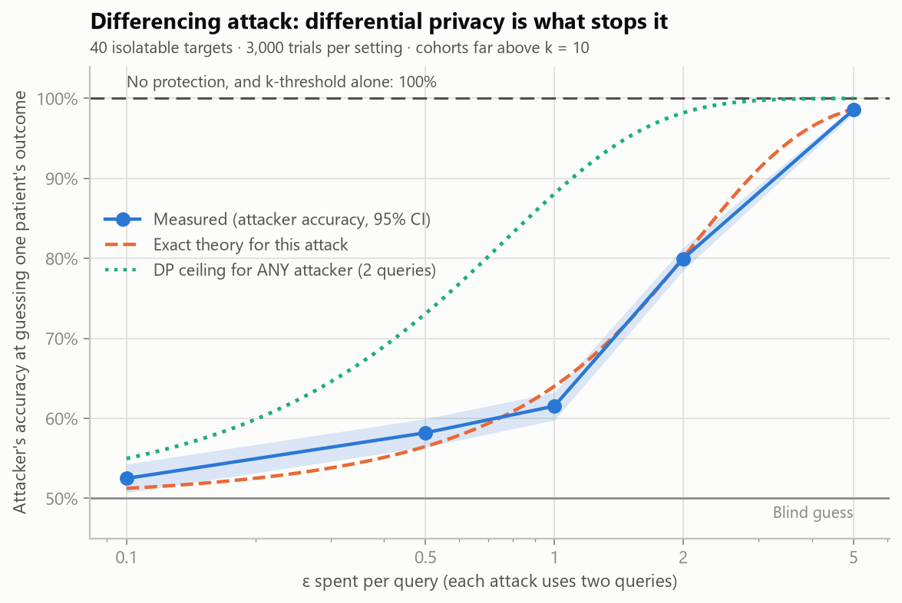
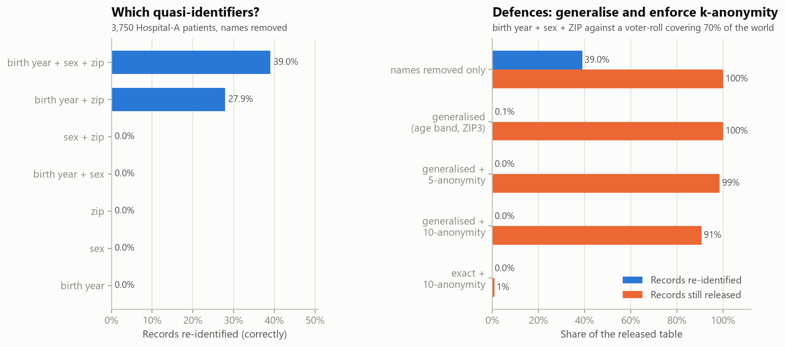
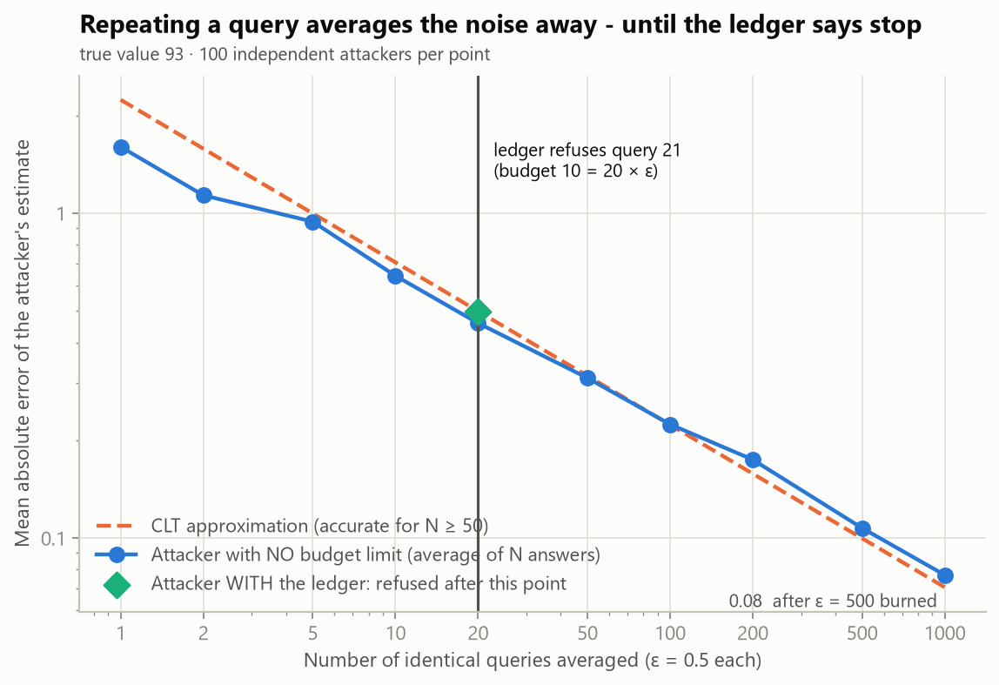
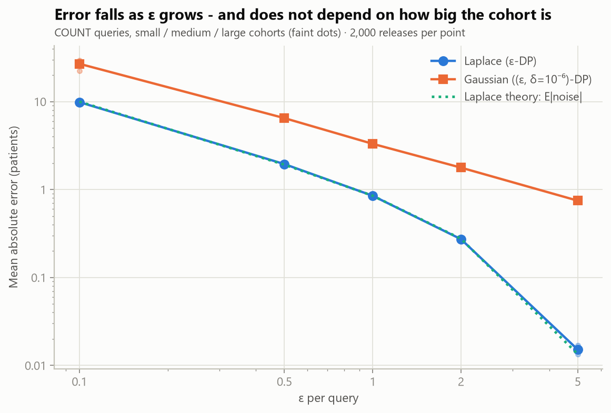
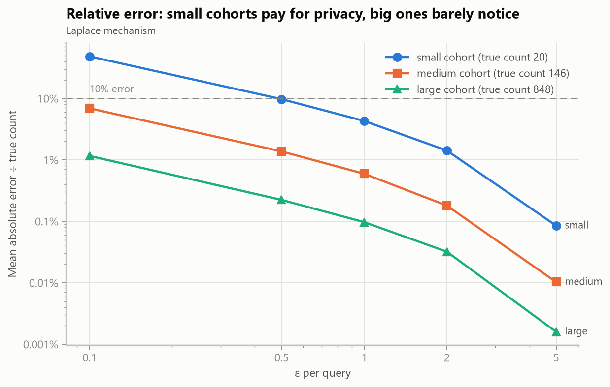
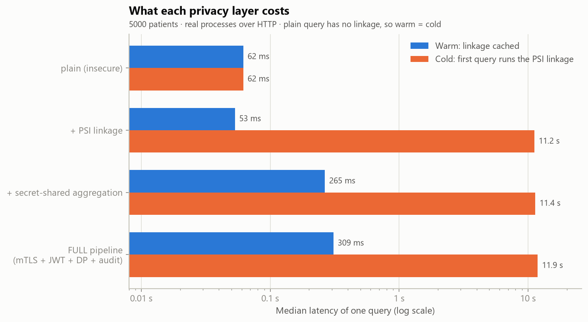
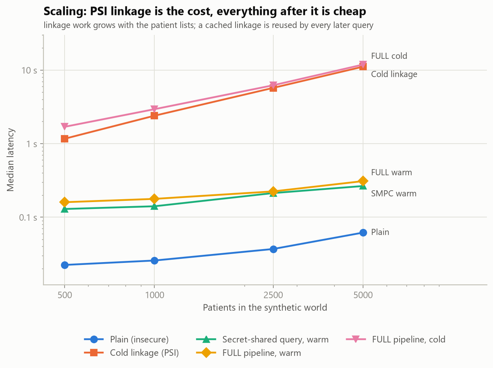
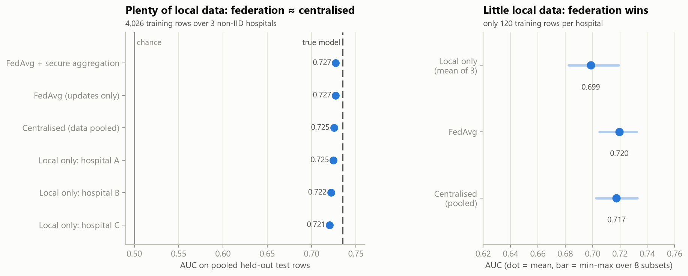
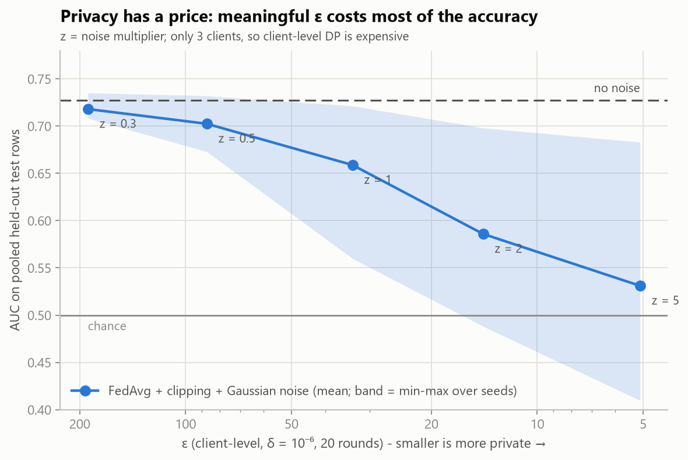

# Evaluation results

*Generated 2026-10-06 by `evaluation/make_report.py` from `evaluation/results/*.json` - every number below is a measurement from `python evaluation/run_all.py`, none is hand-typed. Synthetic data only; see THREAT_MODEL.md for what these results do and do not show.*

## 1. Attack demonstrations - why each defence matters

### Attack 1 - Differencing

40 targets (20 responders, 20 non-responders), 3,000 trials per setting. Exact counts were obtained through the real PSI + MPC pipeline (80 distinct queries, each checked against ground truth); the noise is re-drawn through the real release stage.

| setting | ε per query | attacker accuracy (95% CI) | exact theory | DP ceiling |
|---|---|---|---|---|
| no protection (exact answers) | - | 100.0% (100%-100%) | - | - |
| k-threshold only (k=10, no noise) | - | 100.0% (100%-100%) | - | - |
| k-threshold + differential privacy | 0.1 | 52.5% (51%-54%) | 51.3% | 55.0% |
| k-threshold + differential privacy | 0.5 | 58.2% (56%-60%) | 56.5% | 73.1% |
| k-threshold + differential privacy | 1 | 61.5% (60%-63%) | 64.0% | 88.1% |
| k-threshold + differential privacy | 2 | 80.0% (78%-81%) | 80.1% | 98.2% |
| k-threshold + differential privacy | 5 | 98.6% (98%-99%) | 98.7% | 100.0% |

* With exact answers - and with the k-threshold alone - the attacker identifies the target's outcome in **100%** and **100%** of trials: both queries cover cohorts far above k, so nothing is suppressed.
* The k-threshold does stop the *direct* question: it suppressed 40 of 40 single-patient queries (without it, 40 of 40 would have leaked).
* Differential privacy brings the attacker down to **52.5% at ε = 0.1**, 61.5% at ε = 1 and 98.6% at ε = 5 (blind guessing = 50%). The measured values track the exact formula for this attack and stay below the DP ceiling for any attacker.
* ε = 5 per query offers almost no protection against this attack - the number to quote is the *per-patient* privacy loss, not 'DP is on'.



### Attack 2 - Re-identification of a 'de-identified' release

Released: 3,750 Hospital-A patients with names and IDs removed. Auxiliary 'voter roll': 3,550 people (70% of the world).

| quasi-identifiers | records unique in the release | re-identified (correctly) | precision of claims |
|---|---|---|---|
| birth_year | 0.0% | 0.0% | - |
| sex | 0.0% | 0.0% | - |
| zip | 0.0% | 0.0% | - |
| birth_year + sex | 0.0% | 0.0% | - |
| birth_year + zip | 38.6% | 27.9% | 82% |
| sex + zip | 0.0% | 0.0% | - |
| birth_year + sex + zip | 53.8% | 39.0% | 87% |

| defence | re-identified | records still released | smallest group |
|---|---|---|---|
| exact birth year + sex + ZIP5 (names removed only) | 39.0% | 100% | 1 |
| age band + sex + ZIP3 (generalised) | 0.1% | 100% | 1 |
| generalised + 5-anonymity | 0.0% | 99% | 5 |
| generalised + 10-anonymity | 0.0% | 91% | 10 |
| exact + 10-anonymity | 0.0% | 1% | 10 |

* Removing names is not anonymisation: **39.0%** of records are re-identified from birth year + sex + ZIP alone.
* Generalising the quasi-identifiers (age band, 3-digit ZIP) cuts that to 0.1% at no cost in records; k-anonymity removes the rest but discards records.
* This system never exports rows; reaching the same information through the query interface requires differencing (attack 1), which DP defeats.



### Attack 3 - Budget exhaustion (averaging out the noise)

Target: `count(E11, age 40-65, metformin, improved)`, true value 93, ε = 0.5 per query (one query's expected |error| = 1.92). 100 independent attackers per point.

| queries averaged | ε burned | mean abs error (no ledger) | CLT approximation |
|---|---|---|---|
| 1 | 0.5 | 1.600 | 2.233 |
| 2 | 1 | 1.135 | 1.579 |
| 5 | 2.5 | 0.942 | 0.999 |
| 10 | 5 | 0.642 | 0.706 |
| 20 | 10 | 0.459 | 0.499 |
| 50 | 25 | 0.311 | 0.316 |
| 100 | 50 | 0.224 | 0.223 |
| 200 | 100 | 0.174 | 0.158 |
| 500 | 250 | 0.107 | 0.100 |
| 1000 | 500 | 0.077 | 0.071 |

* Without a limit the error falls like 1/sqrt(N): after 1000 queries it is 0.077 - privacy bought back by volume.
* **With the ledger** (budget 10), driven through the real pipeline: 20 of 30 attempts were answered, the first refusal came at query **21**, ε spent 10. The attacker is stuck with the average of those 20 answers: in this run it is off by 0.05 (a single run; the typical error after 20 answers is ≈0.50) - and no further query is answered.
* Not covered: an attacker with several accounts, or colluding requesters (each has an own budget).



### Attack 4 (bonus) - Dictionary attack on HMAC pseudonyms

Hospital B published 3,150 HMAC tokens (2,400 also at A, 500 only at B). The attacker holds the shared key and tries 204,976 candidate IDs.

* Recovered **3,150 of 3,150** of B's patients, including 500 that A never treated; false positives: 0.
* One core tests 214,193 IDs/s, so the whole 9-digit ID space takes about **70 minutes**.
* Against PSI the same attacker recovers **0 of 103** non-shared patients.

## 2. Accuracy vs privacy

2,000 releases per cell through the real release stage (k = 10). Exact aggregates come from the real private pipeline and were checked against ground truth.

**Laplace** - mean absolute error in patients (relative error)

| cohort | ε = 0.1 | ε = 0.5 | ε = 1 | ε = 2 | ε = 5 |
|---|---|---|---|---|---|
| small (n=20) | 9.66 (48.3%) | 1.95 (9.7%) | 0.86 (4.3%) | 0.28 (1.4%) | 0.02 (0.09%) |
| medium (n=146) | 10.08 (6.9%) | 2.00 (1.4%) | 0.87 (0.59%) | 0.26 (0.18%) | 0.01 (0.01%) |
| large (n=848) | 9.84 (1.2%) | 1.89 (0.22%) | 0.82 (0.10%) | 0.27 (0.03%) | 0.01 (0.00%) |

**Gaussian** - mean absolute error in patients (relative error)

| cohort | ε = 0.1 | ε = 0.5 | ε = 1 | ε = 2 | ε = 5 |
|---|---|---|---|---|---|
| small (n=20) | 22.51 (112.5%) | 6.41 (32.1%) | 3.28 (16.4%) | 1.80 (9.0%) | 0.75 (3.7%) |
| medium (n=146) | 29.57 (20.3%) | 6.46 (4.4%) | 3.35 (2.3%) | 1.73 (1.2%) | 0.75 (0.51%) |
| large (n=848) | 28.64 (3.4%) | 6.60 (0.78%) | 3.30 (0.39%) | 1.79 (0.21%) | 0.75 (0.09%) |

**Other aggregates** (Laplace) - mean absolute error

| query | ε = 0.1 | ε = 0.5 | ε = 1 | ε = 2 | ε = 5 |
|---|---|---|---|---|---|
| AVG adherence (percentage points), avg adherence, n=848 | 2.99 | 0.62 | 0.30 | 0.16 | 0.06 |
| HISTOGRAM, per bin (patients), 3 bins, n=848 | 10.07 | 1.95 | 0.84 | 0.27 | 0.01 |

* The absolute error depends only on ε: ≈0.86 patients at ε = 1 (theory 0.85), ≈9.7 at ε = 0.1, for every cohort size.
* What it costs relatively differs hugely: at ε = 0.5 the small cohort (n=20) is off by 10%, the large one (n=848) by 0.2%.
* The Gaussian mechanism (δ = 10⁻⁶) is noisier than Laplace for a single count at these ε; its advantage appears with many composed queries.
* A histogram's bins all share one ε (parallel composition), so each bin is as accurate as a single count.





## 3. Performance overhead

Median wall-clock latency of one count query through the coordinator, against real uvicorn processes over HTTP (15 warm repetitions, 3 cold; FULL cold is a single first query after start-up). Machine: AMD64 Family 25 Model 68 Stepping 1, AuthenticAMD, 16 logical CPUs, Python 3.13.7, gmpy2 on.

| patients | plain | +PSI cold | +PSI warm | +SMPC cold | +SMPC warm | FULL cold | FULL warm |
|---|---|---|---|---|---|---|---|
| 500 | 22 ms | 1.20 s | 23 ms | 1.31 s | 129 ms | 1.70 s | 160 ms |
| 1000 | 26 ms | 2.43 s | 25 ms | 2.48 s | 141 ms | 2.94 s | 177 ms |
| 2500 | 37 ms | 5.78 s | 37 ms | 5.96 s | 213 ms | 6.22 s | 224 ms |
| 5000 | 62 ms | 11.2 s | 53 ms | 11.4 s | 265 ms | 11.9 s | 309 ms |

'FULL' = strict deployment: mutual TLS, service tokens, JWT login + RBAC, ε-ledger, k-threshold, DP noise and audit entry. 'PSI' stages use the insecure per-index aggregation (isolating the linkage cost); 'SMPC' stages return the EXACT answer (isolating the secret-shared computation).

Warm secret-shared query at 5,000 patients, breakdown: prepare 42 ms, share 34 ms, triples 77 ms, multiply 98 ms.

* **Linkage dominates.** A cold query at 5,000 patients takes 11.9 s; once the linkage is cached the full pipeline answers in 309 ms - 5× the plain insecure join (62 ms).
* Cold linkage cost grows with the patient lists (500: 1.17 s, 1,000: 2.40 s, 2,500: 5.73 s, 5,000: 11.1 s).
* Pure-Python modular exponentiation (no gmpy2) makes the cold linkage at 1,000 patients take 14.1 s vs 2.40 s with gmpy2 (6× faster).
* Login (scrypt) costs 164 ms once per session.





## 4. Federated learning (stretch goal)

FedAvg logistic regression predicting treatment response; 20 rounds, 3 local epochs. Each hospital holds its own `training_episodes` registry (A: 1,245, B: 1,424, C: 1,357 training rows; mean age A 57.4, B 63.6, C 60.1 - deliberately non-IID). FedAvg runs through the real hospital services; test rows are read offline.

| method | AUC (pooled test rows) |
|---|---|
| centralised (pooled data) | 0.7252 |
| **FedAvg** (real services, updates only) | 0.7272 |
| FedAvg + secure aggregation | 0.7272 |
| local only - hospital A | 0.7246 |
| local only - hospital B | 0.7219 |
| local only - hospital C | 0.7205 |
| true model (generator's own coefficients) | 0.7352 |

* **FedAvg matches centralised training** (AUC 0.727 vs 0.725, ceiling 0.735) although no row ever left a hospital; secure aggregation changes the model by at most 1.1e-07 per weight.
* It recovers the clinical signal: adherence coefficient 0.76 (true 0.70), age -0.19 (-0.23), extra comorbidities -0.22 (-0.25); drug-effect coefficients correlate 0.60 with the truth.
* **With plenty of local data federation adds little** - every hospital alone already reaches 0.721-0.725. **With little local data it helps**: at 120 rows per hospital (mean of 8 random subsets) local-only models reach 0.699, FedAvg 0.720 (+0.021), pooled training 0.717.

**Adding differential privacy (clipped updates + Gaussian noise; client-level, δ = 10⁻⁶):**

| noise multiplier z | ε (zCDP, 20 rounds) | AUC mean | AUC min - max over seeds |
|---|---|---|---|
| 0.3 | 189 | 0.718 | 0.708 - 0.735 |
| 0.5 | 87 | 0.702 | 0.673 - 0.732 |
| 1.0 | 34 | 0.659 | 0.560 - 0.721 |
| 2.0 | 14 | 0.586 | 0.488 - 0.698 |
| 5.0 | 5 | 0.531 | 0.410 - 0.683 |

* Accuracy degrades monotonically with noise: light noise costs little but its ε is huge (hundreds); a single-digit ε leaves a model close to chance. With only three clients, *client-level* DP is expensive - and it protects a hospital's whole contribution, **not** individual records (record-level DP-SGD is not implemented).
* Not covered: model memorisation / membership inference on the trained weights, poisoning by a malicious hospital, and verification of updates.





## How to reproduce

```bash
python evaluation/run_all.py            # everything (several minutes at 5,000 patients)
python evaluation/run_all.py --fast     # 1,000 patients, insecure 768-bit PSI group - smoke test only
```
