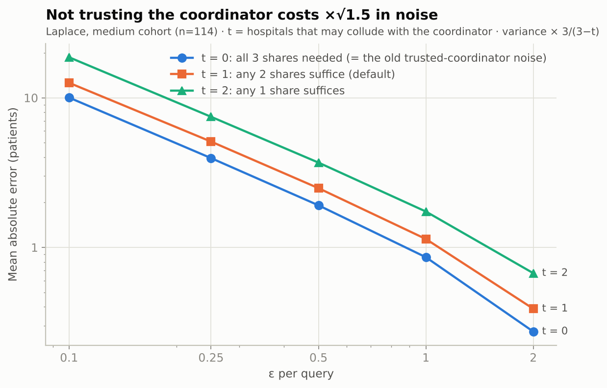
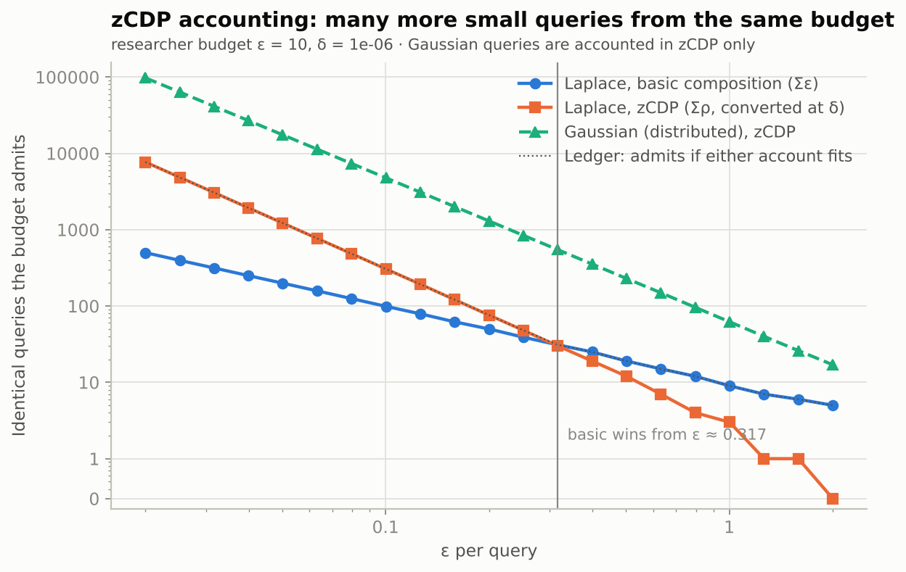

# Evaluation results

*Generated 2026-10-12 by `evaluation/make_report.py` from `evaluation/results/*.json` - every number below is a measurement from `python evaluation/run_all.py`, none is hand-typed. Synthetic patients only (Synthea); see THREAT_MODEL.md and SECURITY_THEOREMS.md for what these results do and do not show.*

## 0. Data

The evaluation world is 5,000 adults from **Synthea** synthetic patients (Massachusetts; the shipped extract in `synthea/`, mapped by `fedhealth/synth/synthea.py`), as of 2025-12-31, split into the three hospitals (A: 3,814, B: 2,862, C: 3,255); 1,756 are at all three.

| code | condition | episodes | treated | with an outcome | improved | most prescribed |
|---|---|---|---|---|---|---|
| E11 | Type 2 diabetes mellitus | 1,946 | 721 | 694 | 46% | metformin, insulin NPH/regular 70/30, liraglutide |
| I10 | Essential hypertension | 3,210 | 3,210 | 3,177 | 45% | lisinopril, hydrochlorothiazide, amlodipine |
| E78 | Hyperlipidaemia | 1,480 | 1,475 | 1,412 | 37% | simvastatin |
| J45 | Asthma | 599 | 599 | 12 | 33% | salbutamol, budesonide, fluticasone |
| J44 | Chronic obstructive pulmonary disease | 277 | 271 | 256 | 24% | fluticasone-salmeterol, salbutamol |
| N18 | Chronic kidney disease | 1,125 | 243 | 236 | 57% | epoetin alfa |
| I50 | Heart failure | 49 | 48 | 19 | 58% | furosemide, carvedilol, losartan |
| F32 | Major depressive disorder | 75 | 55 | 0 | - | fluoxetine |

* Outcomes are derived from Synthea's own lab and vital-sign series (baseline before treatment vs follow-up after at least 90 days; see the mapping notes in `fedhealth/synth/synthea.py`). Synthea records almost no follow-up PHQ-9 for depression and only a spirometry proxy for asthma, so F32 and J45 have few or no outcomes; queries about them still run, they just count few patients.
* Adherence is a refill-coverage proxy (Synthea fills prescriptions on schedule), so it is high and narrow.

## 1. Attack demonstrations - why each defence matters

### Attack 1 - Differencing

40 targets (20 responders, 20 non-responders), 3,000 trials per setting. Exact counts were obtained through the real PSI + MPC pipeline (71 distinct queries, each checked against ground truth); the noise is re-drawn through the real release stage.

| setting | ε per query | requester's accuracy (95% CI) | exact theory | coordinator + 1 hospital (theory) | DP ceiling |
|---|---|---|---|---|---|
| no protection (exact answers) | - | 100.0% (100%-100%) | - | - | - |
| k-threshold only (k=10, no noise) | - | 100.0% (100%-100%) | - | - | - |
| k-threshold + differential privacy | 0.1 | 51.4% (50%-53%) | 50.9% | 51.3% | 55.0% |
| k-threshold + differential privacy | 0.5 | 54.5% (53%-56%) | 54.8% | 56.5% | 73.1% |
| k-threshold + differential privacy | 1 | 60.1% (58%-62%) | 60.3% | 64.0% | 88.1% |
| k-threshold + differential privacy | 2 | 73.9% (72%-75%) | 74.6% | 80.1% | 98.2% |
| k-threshold + differential privacy | 5 | 98.2% (98%-99%) | 98.0% | 98.7% | 100.0% |

* With exact answers - and with the k-threshold alone - the attacker identifies the target's outcome in **100%** and **100%** of trials: both queries cover cohorts far above k, so nothing is suppressed.
* The k-threshold does stop the *direct* question: it suppressed 40 of 40 single-patient queries (without it, 40 of 40 would have leaked).
* Differential privacy brings the attacker down to **51.4% at ε = 0.1**, 60.1% at ε = 1 and 98.2% at ε = 5 (blind guessing = 50%). The measured values track the exact formula for this attack and stay below the DP ceiling for any attacker.
* ε = 5 per query offers almost no protection against this attack - the number to quote is the *per-patient* privacy loss, not 'DP is on'. (The hospitals refuse more than ε = 2 per query by default; ε = 5 is shown for the trend.)
* The noise is now the sum of three hospitals' shares, any two of which already give ε-DP. The requester sees all three (slightly more noise than ε needs); the coordinator colluding with one hospital can subtract that hospital's share and is left with exactly ε-DP noise - the 'coordinator + 1 hospital' column, still below the DP ceiling.


### Attack 2 - Re-identification of a 'de-identified' release

Released: 3,814 Hospital-A patients with names and IDs removed. Auxiliary 'voter roll': 3,550 people (70% of the world).

| quasi-identifiers | records unique in the release | re-identified (correctly) | precision of claims |
|---|---|---|---|
| birth_year | 0.0% | 0.0% | - |
| sex | 0.0% | 0.0% | - |
| zip | 0.6% | 0.5% | 49% |
| birth_year + sex | 0.1% | 0.1% | 50% |
| birth_year + zip | 57.7% | 41.2% | 91% |
| sex + zip | 2.2% | 1.7% | 51% |
| birth_year + sex + zip | 64.8% | 46.1% | 94% |

| defence | re-identified | records still released | smallest group |
|---|---|---|---|
| exact birth year + sex + ZIP5 (names removed only) | 46.1% | 100% | 1 |
| age band + sex + ZIP3 (generalised) | 0.2% | 100% | 1 |
| generalised + 5-anonymity | 0.0% | 97% | 5 |
| generalised + 10-anonymity | 0.0% | 90% | 10 |
| exact + 10-anonymity | 0.0% | 14% | 10 |

* Removing names is not anonymisation: **46.1%** of records are re-identified from birth year + sex + ZIP alone.
* Generalising the quasi-identifiers (age band, 3-digit ZIP) cuts that to 0.2% at no cost in records; k-anonymity removes the rest but discards records.
* This system never exports rows; reaching the same information through the query interface requires differencing (attack 1), which DP defeats.


### Attack 3 - Budget exhaustion (averaging out the noise)

Target: `count(E11, age 40-65, metformin, improved)`, true value 81, ε = 0.5 per query (one query's expected |error| = 2.48). 100 independent attackers per point.

| queries averaged | ε burned | mean abs error (no ledger) | CLT approximation |
|---|---|---|---|
| 1 | 0.5 | 2.240 | 2.735 |
| 2 | 1 | 1.775 | 1.934 |
| 5 | 2.5 | 1.278 | 1.223 |
| 10 | 5 | 0.998 | 0.865 |
| 20 | 10 | 0.708 | 0.612 |
| 50 | 25 | 0.387 | 0.387 |
| 100 | 50 | 0.287 | 0.274 |
| 200 | 100 | 0.207 | 0.193 |
| 500 | 250 | 0.118 | 0.122 |
| 1000 | 500 | 0.088 | 0.087 |

* Without a limit the error falls like 1/sqrt(N): after 1000 queries it is 0.088 - privacy bought back by volume.
* **With the ledger** (budget 10), driven through the real pipeline: 20 of 30 attempts were answered, the first refusal came at query **21**, ε spent 10. The attacker is stuck with the average of those 20 answers: in this run it is off by 0.65 (a single run; the typical error after 20 answers is ≈0.61) - and no further query is answered.
* Pure ε = 0.5 queries are cheapest under basic composition here (20 queries); zCDP would admit 12 - the ledger takes whichever admits more (section 2).
* Not covered: an attacker with several accounts, or colluding requesters (each has an own budget).


### Attack 4 (bonus) - Dictionary attack on HMAC pseudonyms

Hospital B published 2,862 HMAC tokens (2,174 also at A, 463 only at B). The attacker holds the shared key and tries 204,974 candidate IDs.

* Recovered **2,862 of 2,862** of B's patients, including 463 that A never treated; false positives: 0.
* One core tests 324,047 IDs/s, so the whole 9-digit ID space takes about **46 minutes**.
* Against PSI the same attacker recovers **0 of 125** non-shared patients.

## 2. Accuracy vs privacy

20,000 releases per cell (k = 10). The noise is what the hospitals add inside the secure computation: three shares (two computing hospitals + the triple dealer), sized so that any two of them give ε-DP (collusion tolerance t = 1). Exact aggregates come from the real private pipeline and were checked against ground truth; the noise is drawn with the vectorised simulation of the hospitals' exact samplers.

**Laplace** - mean absolute error in patients (relative error)

| cohort | ε = 0.1 | ε = 0.25 | ε = 0.5 | ε = 1 | ε = 2 |
|---|---|---|---|---|---|
| small (n=20) | 12.77 (63.9%) | 5.09 (25.4%) | 2.47 (12.4%) | 1.12 (5.6%) | 0.39 (2.0%) |
| medium (n=114) | 12.52 (11.0%) | 5.01 (4.4%) | 2.45 (2.1%) | 1.13 (0.99%) | 0.39 (0.34%) |
| large (n=717) | 12.74 (1.8%) | 5.08 (0.71%) | 2.47 (0.34%) | 1.13 (0.16%) | 0.39 (0.05%) |
| theory: E\|noise\| | 12.72 | 5.06 | 2.48 | 1.13 | 0.39 |

**Gaussian** - mean absolute error in patients (relative error)

| cohort | ε = 0.1 | ε = 0.25 | ε = 0.5 | ε = 1 | ε = 2 |
|---|---|---|---|---|---|
| small (n=20) | 38.65 (193.3%) | 16.27 (81.3%) | 8.48 (42.4%) | 4.43 (22.1%) | 2.31 (11.6%) |
| medium (n=114) | 38.60 (33.9%) | 16.33 (14.3%) | 8.51 (7.5%) | 4.40 (3.9%) | 2.32 (2.0%) |
| large (n=717) | 38.44 (5.4%) | 16.28 (2.3%) | 8.45 (1.2%) | 4.43 (0.62%) | 2.31 (0.32%) |
| theory: E\|noise\| | 38.56 | 16.28 | 8.48 | 4.43 | 2.33 |

**Other aggregates** (Laplace) - mean absolute error

| query | ε = 0.1 | ε = 0.25 | ε = 0.5 | ε = 1 | ε = 2 |
|---|---|---|---|---|---|
| AVG adherence (percentage points), avg adherence, n=1272 | 1.43 | 0.59 | 0.29 | 0.15 | 0.07 |
| HISTOGRAM, per bin (patients), 3 bins, n=1272 | 12.66 | 5.05 | 2.48 | 1.13 | 0.39 |

**The k-threshold now looks at the noisy count** - share of releases suppressed (Laplace)

| cohort | ε = 0.1 | ε = 0.25 | ε = 0.5 | ε = 1 | ε = 2 |
|---|---|---|---|---|---|
| small (n=20) | 23.0% | 5.9% | 0.5% | 0.0% | 0.0% |
| medium (n=114) | 0.0% | 0.0% | 0.0% | 0.0% | 0.0% |

* The absolute error depends only on ε: ≈1.12 patients at ε = 1 (theory 1.13), ≈12.8 at ε = 0.1, for every cohort size.
* What it costs relatively differs hugely: at ε = 0.5 the small cohort (n=20) is off by 12%, the large one (n=717) by 0.3%.
* The Gaussian mechanism (δ = 10⁻⁶) is noisier than Laplace for a single count at these ε; its advantage is in composition (below).
* A histogram's bins all share one ε (parallel composition), so each bin is as accurate as a single count.
* Suppression is no longer a hard cut at the exact count: a cohort near k is sometimes released and sometimes not. That fuzziness is what closes the old side channel (the decision is a function of the noisy count only, so it is covered by the DP guarantee).


### The price of not trusting the coordinator

The same medium-cohort count with the noise sized for t = 0, 1, 2 hospitals colluding with the coordinator. t = 0 is exactly the noise the old design added centrally, at the coordinator.

| mechanism | t | shares that must stay secret | ε = 0.1 | ε = 0.25 | ε = 0.5 | ε = 1 | ε = 2 |
|---|---|---|---|---|---|---|---|
| laplace | 0 | 3 of 3 | 10.03 | 3.95 | 1.91 | 0.86 | 0.27 |
| laplace | 1 | 2 of 3 | 12.59 | 5.09 | 2.49 | 1.14 | 0.39 |
| laplace | 2 | 1 of 3 | 18.65 | 7.46 | 3.69 | 1.74 | 0.67 |
| gaussian | 0 | 3 of 3 | 31.51 | 13.24 | 6.87 | 3.61 | 1.85 |
| gaussian | 1 | 2 of 3 | 38.39 | 16.09 | 8.53 | 4.39 | 2.32 |
| gaussian | 2 | 1 of 3 | 54.49 | 23.13 | 11.96 | 6.28 | 3.26 |

* The default (t = 1) costs ×1.32 in mean absolute error at ε = 1 over a trusted coordinator (variance ×1.5); in exchange the coordinator never sees an exact count, and even the coordinator plus one hospital get ε-DP.



### Budget accounting: zCDP next to basic composition

How many identical queries one researcher budget (ε = 10, δ = 1e-06) admits.

| ε per query | Laplace, basic Σε | Laplace, zCDP | Laplace, ledger | Gaussian, zCDP |
|---|---|---|---|---|
| 0.02 | 500 | 7696 | 7696 | 97547 |
| 0.0502 | 199 | 1221 | 1221 | 17481 |
| 0.1262 | 79 | 193 | 193 | 3095 |
| 0.317 | 31 | 30 | 31 | 546 |
| 0.7962 | 12 | 4 | 12 | 96 |
| 2 | 5 | 0 | 5 | 17 |

* Below ε ≈ 0.317 per query zCDP admits more (ρ adds up, ε grows like √k); above it a few large pure-DP queries fit better under basic composition. The ledger keeps both accounts and admits a query if either still fits - Theorem 2 of SECURITY_THEOREMS.md shows the requester's guarantee is still (ε, δ) of the budget.
* Gaussian queries are accounted in zCDP only (with the Kairouz-Liu-Steinke term for distributed discrete Gaussian noise), where they are far cheaper than any (ε, δ) sum.



## 3. Performance overhead

Median wall-clock latency of one count query through the coordinator, against real uvicorn processes over HTTP (15 warm repetitions, 3 cold; FULL cold is a single first query after start-up). Machine: x86_64, 4 logical CPUs, Python 3.13.16, gmpy2 off.

| patients | plain | +PSI cold | +PSI warm | +SMPC cold | +SMPC warm | FULL cold | FULL warm |
|---|---|---|---|---|---|---|---|
| 500 | 18 ms | 54.7 s | 18 ms | 54.4 s | 421 ms | 54.1 s | 460 ms |
| 1000 | 22 ms | 53.5 s | 17 ms | 53.6 s | 426 ms | 52.9 s | 439 ms |
| 2500 | 28 ms | 53.4 s | 27 ms | 54.7 s | 438 ms | 54.3 s | 468 ms |
| 5000 | 51 ms | 55.0 s | 47 ms | 55.1 s | 436 ms | 55.2 s | 472 ms |

'FULL' = strict deployment: mutual TLS, service tokens, JWT login + RBAC, ε-ledger, hospital-generated noise shares inside the MPC, k-threshold and audit entry. 'PSI' stages use the insecure per-index aggregation (isolating the linkage cost); 'SMPC' stages return the EXACT answer (isolating the secret-shared computation).

Warm secret-shared query at 5,000 patients, breakdown: prepare 269 ms, share 28 ms, triples from the dealer hospital 58 ms, multiply 62 ms.

* **Linkage dominates.** A cold query at 5,000 patients takes 55.2 s; once the linkage is cached the full pipeline answers in 472 ms - 9× the plain insecure join (51 ms).
* Cold linkage at each size (500: 54.4 s, 1,000: 53.4 s, 2,500: 53.0 s, 5,000: 54.7 s): every PSI list is padded to the public bound M, so the cost is set by M, not by how many patients a hospital has.
* gmpy2 was not installed on this machine, so every linkage time above uses pure-Python modular exponentiation (`pip install -e ".[fast]"` makes the cold linkage several times faster; the warm query does not use it).
* Login (scrypt) costs 71 ms once per session.
* Drawing one hospital's noise share with the exact samplers: COUNT ε=1 0.07 ms, COUNT ε=0.1 0.17 ms, HISTOGRAM ε=1 0.15 ms, SUM age ε=1 1.47 ms, SUM lab ε=1 3.09 ms, COUNT Gaussian ε=1 0.05 ms.
* **Public prepare deadline.** Every hospital answers `prepare` (its predicate and its noise draw) at a public deadline: 255 ms for an exact count, plus an allowance per unit of noise scale for a noisy one. So the prepare time above is the deadline, not the work, and the cost is a latency floor. With the deadlines switched off, the slowest prepare over 6 query shapes took 114 ms (COUNT broad; medians COUNT narrow 23 ms, COUNT broad 45 ms, SUM lab 24 ms, AVG age 40 ms, HISTOGRAM drug 38 ms, HISTOGRAM age band 27 ms). 0 of 60 warm prepares overran the deadline.


## 4. Federated learning (stretch goal)

FedAvg logistic regression predicting treatment response; 20 rounds, 3 local epochs. Each hospital holds its own `training_episodes` registry (A: 1,245, B: 1,424, C: 1,357 training rows; mean age A 57.4, B 63.6, C 60.1 - deliberately non-IID). FedAvg runs through the real hospital services; test rows are read offline.

| method | AUC (pooled test rows) |
|---|---|
| centralised (pooled data) | 0.7252 |
| **FedAvg** (real services, updates only) | 0.7272 |
| FedAvg + secure aggregation | 0.7272 |
| local only - hospital A | 0.7246 |
| local only - hospital B | 0.7219 |
| local only - hospital C | 0.7205 |
| true model (generator's own coefficients) | 0.7352 |

* **FedAvg matches centralised training** (AUC 0.727 vs 0.725, ceiling 0.735) although no row ever left a hospital; secure aggregation changes the model by at most 1.1e-07 per weight.
* It recovers the clinical signal: adherence coefficient 0.76 (true 0.70), age -0.19 (-0.23), extra comorbidities -0.22 (-0.25); drug-effect coefficients correlate 0.59 with the truth.
* **With plenty of local data federation adds little** - every hospital alone already reaches 0.721-0.725. **With little local data it helps**: at 120 rows per hospital (mean of 8 random subsets) local-only models reach 0.699, FedAvg 0.720 (+0.021), pooled training 0.717.

**Adding differential privacy (clipped updates + Gaussian noise; client-level, δ = 10⁻⁶):**

| noise multiplier z | ε (zCDP, 20 rounds) | AUC mean | AUC min - max over seeds |
|---|---|---|---|
| 0.3 | 189 | 0.721 | 0.704 - 0.734 |
| 0.5 | 87 | 0.707 | 0.674 - 0.731 |
| 1.0 | 34 | 0.667 | 0.584 - 0.721 |
| 2.0 | 14 | 0.599 | 0.484 - 0.695 |
| 5.0 | 5 | 0.536 | 0.430 - 0.675 |

* Accuracy degrades monotonically with noise: light noise costs little but its ε is huge (hundreds); a single-digit ε leaves a model close to chance. With only three clients, *client-level* DP is expensive - and it protects a hospital's whole contribution, **not** individual records (record-level DP-SGD is not implemented).
* Not covered: model memorisation / membership inference on the trained weights, poisoning by a malicious hospital, and verification of updates.


## How to reproduce

```bash
python evaluation/run_all.py            # everything (several minutes at 5,000 patients)
python evaluation/run_all.py --fast     # 1,000 patients, insecure 768-bit PSI group - smoke test only
```
